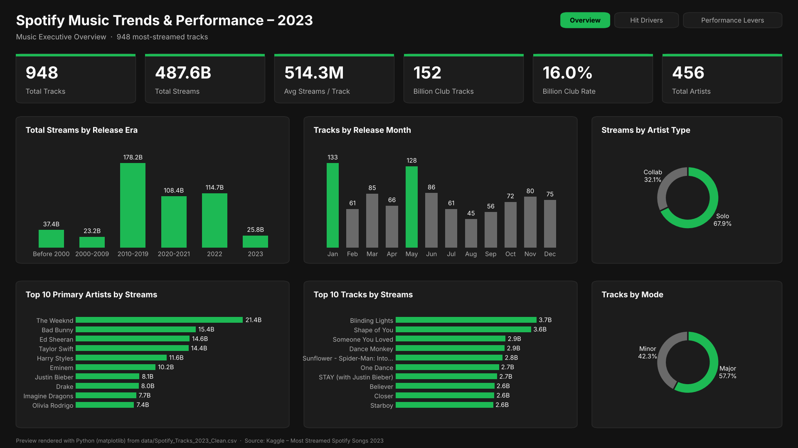
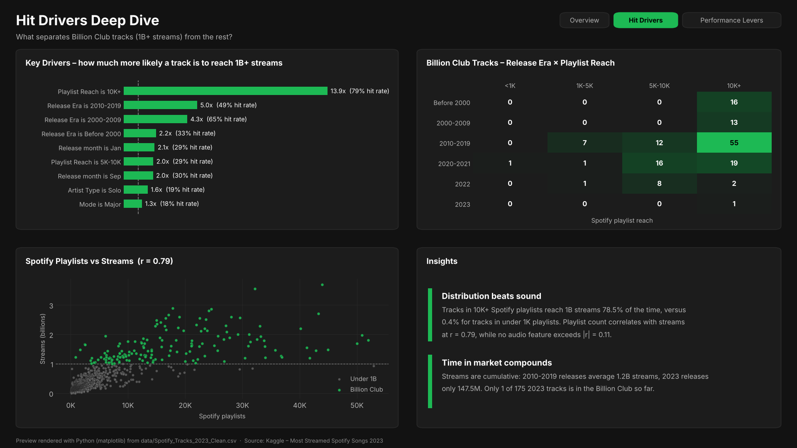
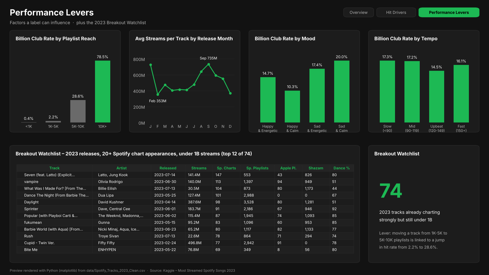
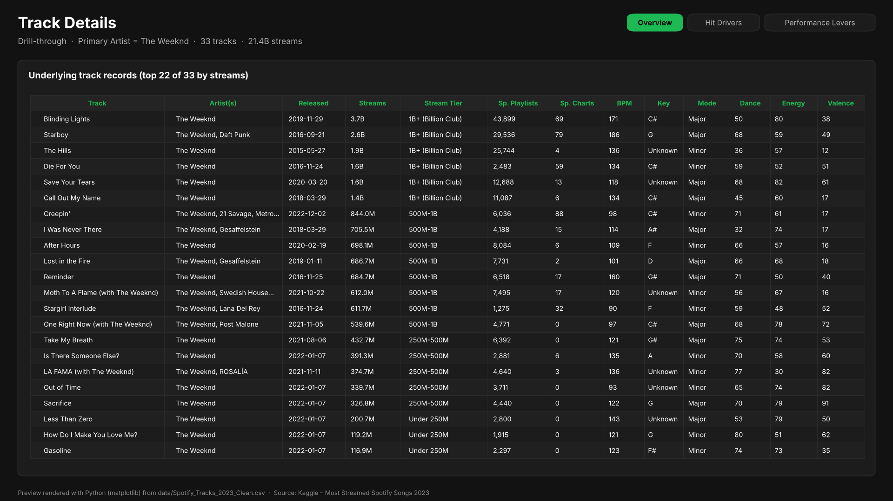

# 🎧 Spotify Music Trends & Performance Analytics Dashboard (Power BI)

**Name:** _Your Name_
**Roll No:** _Your Roll No_

---

## 📌 Overview

This project is an interactive Power BI dashboard that analyses the **948 most-streamed songs on Spotify (2023)**, which together account for **487.6 billion streams**. It answers three questions for music labels, artist managers and playlist curators:

1. **What is performing?** (top tracks, top artists, release eras, solo vs collaboration)
2. **Why do some songs become billion-stream hits?** (playlist reach, chart presence, audio features such as danceability, energy, mood and tempo)
3. **Which new songs are breaking out next, and what can labels do about it?**

The report has four linked pages: a Music Executive Overview, a Hit Drivers Deep Dive, a Performance Levers page and a hidden Track Details page reached by drill-through.

---

## 🎯 Objectives

- Measure total and average streaming performance and see how it varies across release eras, artists, modes and keys.
- Identify what separates **Billion Club** tracks (1B+ streams) from the rest using Key Influencers and the Decomposition Tree.
- Find the performance levers a label can act on (playlist placement, cross-platform presence, release timing).
- Produce a **Breakout Watchlist** of 2023 releases that are charting strongly but have not yet reached 1B streams.

---

## 🗂️ Dataset

**Name:** Most Streamed Spotify Songs 2023 (Kaggle, by Nidula Elgiriyewithana)
**Raw size:** 953 tracks × 24 columns → **Cleaned:** 948 tracks × 26 columns
**Outcome column:** `Is Billion Club` (Yes = **152** tracks, No = **796** tracks)

**Columns used in the dashboard:**

| Category            | Fields |
| ------------------- | ------ |
| Track & artist      | `track_id`, `track_name`, `artist_name`, `artist_count` |
| Release             | `released_year`, `released_month`, `released_day`, `release_date` |
| Spotify performance | `streams`, `in_spotify_playlists`, `in_spotify_charts` |
| Other platforms     | `in_apple_playlists`, `in_apple_charts`, `in_deezer_playlists`, `in_deezer_charts`, `in_shazam_charts` |
| Musical attributes  | `bpm`, `key`, `mode` |
| Audio features (0-100) | `danceability_pct`, `valence_pct`, `energy_pct`, `acousticness_pct`, `instrumentalness_pct`, `liveness_pct`, `speechiness_pct` |

---

## ⚙️ Data Preparation

### 🧹 Cleaning (done before loading into Power BI)

- Fixed text encoding (raw file is Latin-1 → saved as UTF-8).
- Removed **1** corrupted row whose `streams` value contained text.
- Removed **4** duplicate tracks (same track + artist), keeping the higher stream count.
- Converted `in_deezer_playlists` and `in_shazam_charts` from text with thousands separators to numbers; **50** blank Shazam values set to 0.
- Filled **94** missing `key` values with `Unknown`.
- Renamed `artist(s)_name` → `artist_name` and `*_%` → `*_pct`; added `track_id` and `release_date`.

### 🧮 Calculated Columns

- **`Release Era`**: *Before 2000, 2000-2009, 2010-2019, 2020-2021, 2022, 2023*
- **`Stream Tier`**: *Under 250M, 250M-500M, 500M-1B, 1B+ (Billion Club)*
- **`Is Billion Club`**: Yes / No (streams ≥ 1 billion)
- **`Artist Type`**: Solo / Collaboration
- **`Primary Artist`**: first artist listed on the track
- **`Danceability Band`**, **`Energy Band`**: *Low (<50), Medium (50-69), High (70+)*
- **`Mood`**: valence × energy quadrant – *Happy & Energetic, Happy & Calm, Sad & Energetic, Sad & Calm*
- **`Tempo Band`**: *Slow (<90), Mid (90-119), Upbeat (120-149), Fast (150+)* BPM
- **`Playlist Reach`**: Spotify playlist count – *<1K, 1K-5K, 5K-10K, 10K+*

### 📈 DAX Measures

| Measure                    | Purpose |
| -------------------------- | ------- |
| `Total Tracks`             | Count of all tracks |
| `Total Streams`            | Sum of `streams` |
| `Avg Streams per Track`    | Average of `streams` |
| `Billion Club Tracks`      | Tracks with 1B+ streams |
| `Billion Club Rate`        | Billion Club Tracks ÷ Total Tracks |
| `Total Artists`            | Distinct count of `Primary Artist` |
| `Avg Danceability / Energy / Valence / BPM` | Audio-feature averages |
| `Breakout Watchlist Count` | 2023 releases with ≥ 20 Spotify chart appearances and < 1B streams |

All formulas are in [`dax/DAX_Calculated_Columns_and_Measures.md`](dax/DAX_Calculated_Columns_and_Measures.md).

---

## 📊 Dashboard Pages

### 1️⃣ Music Executive Overview



The landing page, giving a high-level view of streaming performance.

**KPI cards:** Total Tracks **948** · Total Streams **487.6B** · Avg Streams/Track **514.3M** · Billion Club Tracks **152** · Billion Club Rate **16.0%** · Total Artists **458**

**Visuals:**

- Column chart: Total Streams by Release Era
- Column chart: Tracks by Release Month
- Bar chart: Top 10 Primary Artists by Streams
- Bar chart: Top 10 Tracks by Streams
- Donut chart: Streams by Artist Type (Solo vs Collaboration)
- Donut chart: Tracks by Mode (Major vs Minor)

**Slicers:** Release Era, Artist Type, Mode, Stream Tier, Key

**Navigation:** buttons to the *Hit Drivers* and *Performance Levers* pages

---

### 2️⃣ Hit Drivers Deep Dive



Root-cause analysis using Power BI's AI-powered visuals.

**Visuals:**

- **Key Influencers** with target `Is Billion Club = Yes`, explained by Playlist Reach, in_spotify_playlists, in_apple_playlists, in_spotify_charts, Release Era, Artist Type, Mode, Danceability Band, Energy Band, Mood and Tempo Band.
- **Decomposition Tree** breaking down the 152 Billion Club tracks by Release Era → Playlist Reach → Artist Type → Mode.
- **Scatter chart** of Spotify Playlists vs Streams, coloured by `Is Billion Club`.
- Two written insight callouts summarising the findings.

**Navigation:** buttons to the *Overview* and *Performance Levers* pages

---

### 3️⃣ Performance Levers



Focuses on the factors a label or artist team can actually influence.

**Visuals:**

- Billion Club Rate by Playlist Reach
- Avg Streams per Track by Release Month
- Billion Club Rate by Mood
- Billion Club Rate by Tempo Band
- **Breakout Watchlist table**: 2023 releases with ≥ 20 Spotify chart appearances and under 1B streams, showing Track, Artist, Release Date, Streams, Spotify Charts, Spotify Playlists, Apple Playlists, Shazam Charts and Danceability
- An insight callout on the breakout group

**Navigation:** buttons to the *Overview* and *Hit Drivers* pages

---

### 4️⃣ Track Details (Drill-through)

**Step 1: Right-click an artist or era on the Overview page → Drill through → Track Details**


**Step 2: The hidden Track Details page opens, filtered to that selection**



The page lists the underlying track records (Track, Artist, Release Date, Streams, Stream Tier, Spotify Playlists, Spotify Charts, BPM, Key, Mode, Danceability, Energy, Valence) so any number on the dashboard can be checked against the raw data. An **Overview** button returns to the main report.

---

## 🔑 Key Insights

- **Scale:** 948 tracks have **487.6B** streams in total; the average track has **514.3M** streams but the median is only **289.2M**, so a small group of mega-hits pulls the average up.
- **Billion Club:** **152 tracks (16.0%)** have crossed 1B streams, and they generate **245.6B streams – just over half (50.4%)** of all streams.
- **Top tracks:** *Blinding Lights* (The Weeknd, **3.70B**), *Shape of You* (Ed Sheeran, **3.56B**) and *Someone You Loved* (Lewis Capaldi, **2.89B**) lead the list.
- **Top artists:** As primary artist, **The Weeknd** leads with **21.4B** streams across 33 tracks, followed by Bad Bunny (**15.4B**) and Ed Sheeran (**14.6B**, from only 13 tracks). Taylor Swift has the most tracks in the list (**36**).
- **Recency vs longevity:** **60.5%** of the tracks were released in 2022-2023, yet songs from **2010-2019** average **1.18B** streams versus **147.5M** for 2023 releases – streams are cumulative, so older catalogue hits keep compounding.
- **Playlist reach is the #1 driver:** Spotify playlist count has the strongest link with streams (**r = 0.79**). Tracks in **10K+ playlists** reach the Billion Club **78.5%** of the time, versus **0.4%** for tracks in under 1K playlists.
- **Cross-platform:** Apple Music playlist presence is almost as strongly linked to streams (**r = 0.77**) – hits are hits everywhere.
- **Solo vs collaboration:** Solo tracks average **568.9M** streams and an **18.9%** Billion Club rate, versus **427.6M** and **11.5%** for collaborations.
- **Mode:** Major-key songs make up **57.7%** of tracks and have a slightly higher Billion Club rate (**17.6%** vs **14.0%** for minor).
- **Audio DNA:** The typical chart song has danceability **69**, energy **66**, valence **51** and **~120 BPM**. Audio features on their own have almost no link with total streams (all |r| ≤ 0.11) – sound gets a song noticed, but distribution decides its scale.
- **Release timing:** January (133 tracks) and May (128) are the busiest release months; January and September releases have the highest Billion Club rates (**29.3%** and **30.4%**).
- **Action list:** **74 tracks released in 2023** already have 20+ Spotify chart appearances but are still under 1B streams – the Breakout Watchlist.

---

## 💡 Recommendations

- Prioritise playlist pitching: moving a track from 1K-5K to 5K-10K playlists is associated with a jump in Billion Club rate from **2.2%** to **28.6%**.
- Focus marketing spend on the **74** Breakout Watchlist tracks, which already have chart momentum.
- Push releases across Apple Music and Deezer playlists as well as Spotify – cross-platform reach moves together with streams.
- Treat catalogue as an asset: 2010-2019 hits are still earning; re-promote them through editorial and nostalgia playlists.
- Use collaborations to reach new audiences, but don't assume they outperform – solo tracks have the higher hit rate in this data.

---

## ⚠️ Limitations

- Stream counts are **cumulative (all-time)** as of 2023, so older songs have an advantage.
- The dataset only includes popular songs, so it shows what separates big hits from smaller hits, not hits from flops.
- Artist totals use the **primary (first-listed) artist** only; features are not double-counted.

---

## ✅ Conclusion

The dashboard shows that streaming success is not random: it is concentrated in a small Billion Club that earns half of all streams, and it is driven far more by **distribution (playlist reach and cross-platform presence) and time in market** than by any single audio feature. By combining an executive summary, root-cause analysis and an action-oriented Breakout Watchlist, it helps a music team move from *reporting* streams to *planning* the next hit.

---

## 📁 Project Structure

```
spotify-trends-dashboard-powerbi/
│
├── data/
│   ├── raw_spotify_2023.csv                    # Original Kaggle file
│   ├── Spotify_Tracks_2023_Clean.csv           # Cleaned data (CSV)
│   └── Spotify_Tracks_2023_Clean.xlsx          # Cleaned data loaded into Power BI
│
├── dax/
│   └── DAX_Calculated_Columns_and_Measures.md  # All DAX formulas
│
├── images/
│   ├── spotifyOverview.png                     # Executive Overview page
│   ├── spotifyDeepDive.png                     # Hit Drivers Deep Dive page
│   ├── spotifyLevers.png                       # Performance Levers page
│   ├── spotifyDrillThrough.png                 # Drill-through menu
│   └── spotifyDetails.png                      # Track Details page
│
├── powerBI/
│   ├── Spotify_Trends_Analytics.pbix           # Power BI dashboard
│   └── spotify_theme.json                      # Custom Spotify dark theme
│
├── scripts/
│   └── clean_data.py                           # Data cleaning script
│
├── BUILD_GUIDE.md                              # Step-by-step dashboard build
├── GIT_STEPS.md                                # How to push this project to GitHub
└── README.md
```

---

## 🛠 Tools Used

- **Python (pandas)**: cleaning the raw Kaggle CSV
- **Power BI Desktop**: report design, Key Influencers, Decomposition Tree, drill-through and page navigation
- **Power Query**: loading and typing the Excel dataset
- **DAX**: calculated columns and measures for streams, Billion Club rate and audio-feature averages

---

## 👤 Author

**_Your Name_**

Dataset credit: [Most Streamed Spotify Songs 2023 – Kaggle](https://www.kaggle.com/datasets/nelgiriyewithana/top-spotify-songs-2023)
